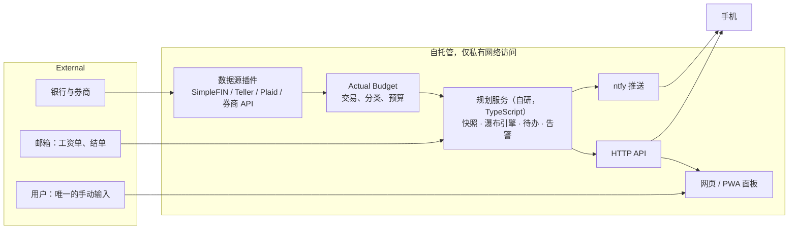

# autopocket 产品需求文档（PRD）

> 状态：草案 v0.2 · 2026-10-20 · 语言：中文（代码与 CLAUDE.md 用英文）

autopocket 是一个自托管的个人财务自动驾驶：开源组件负责同步账户和记账，自研的规划服务把同步数据变成"这个月钱该往哪流"的推演和待办，并在需要行动时推送。目标是日常零手动输入，长期可用，日后可扩展到 iOS。

## 0. 给接手者的说明（先读）

- 本仓库是**公开安全**的版本：所有文档、配置和测试只使用虚构的"示例用户"。真实用户的财务数据只存在于本地未入库的 `config/settings.json`（见 `.gitignore`）和仓库之外的私有资料中。**任何时候都不要把真实数据写进仓库**。
- 你不需要任何先前对话的上下文。按以下顺序阅读：本文 → [`prototype-spec.md`](prototype-spec.md)（原型的精确规则、数据结构、测试向量、界面规格）→ `prototype/` 和 `tests/`。
- 原型是一个可以直接用浏览器打开的单文件页面 `prototype/index.html`，引擎是 `prototype/engine.js`。`npm test` 用测试向量锁定了引擎行为。
- 第 9 节列出待决问题。涉及部署位置、技术选型、数据源选择的决定，开工前向用户确认。
- 硬约束：系统不得执行任何转账或交易；不得明文保存银行凭证；服务不暴露公网。

## 1. 问题与目标

原型能按用户的规则推演未来，但依赖每月底手动填十几个余额；记录过去的开源记账工具能自动同步，却不会按用户自己的优先级规则推演和给出操作。两者各解决一半。

**目标**

1. 账户余额和交易每天自动同步，月底快照自动生成，不再手动打卡
2. 规划引擎每天从最新快照重算：各目标的进度、完成月份、本月该做什么
3. 只在需要行动时通知：发薪日该转多少、阶段切换、预算超支、同步失败
4. 资金执行交给银行端的定期自动转账，系统只负责告诉用户何时调整金额
5. 保留原型的可视化：里程碑、水桶水位、余额走势、资金去向、工资单拆解
6. 长期可用：目标、雇主、税表、生活事件都是配置，人生阶段变化时只改配置不改代码
7. 多端：同一套 API 和同一个引擎支撑网页、PWA 和日后的 iOS app

**非目标**

- 自动执行转账或交易
- 报税：只做估算和提醒
- 多用户、多币种记账（非美元资产只作为手动维护的数字）
- 选股或投资建议
- 商业化、上架应用商店

## 2. 用户与核心场景

目标用户：在美国领 W-2 双周工资的个人，会写代码，能维护一个自托管的小服务。首个支持的报税情形是加州单身申报。

| 场景 | 现在 | 目标体验 |
| --- | --- | --- |
| 发薪日 | 自己算该转多少 | 推送："到手 $X，已按计划自动转 $Y 到高息储蓄；无需操作" |
| 月底 | 打开页面填十几个余额 | 什么都不做，快照已自动生成 |
| 阶段切换（某笔债务还清、某个目标完成） | 自己发现 | 推送："车贷已还清，把自动转账改为每张工资单 $Z 到高息储蓄" |
| 1–4 月补存上一年 Roth IRA | 记得住才做 | 1 月初推送上一年剩余额度和建议金额，4 月 1 日再提醒 |
| 花超了 | 月底才知道 | 某类别超预算 20% 时推送；应急金低于保底时推送 |
| 试算（搬家、换工作） | 打开页面拖滑块 | 同样，数据已是最新 |
| 同步出问题 | 不知道 | 某账户超过 3 天没更新时推送，并说明去哪里重新授权 |

成功的样子：一个季度里用户主动打开系统不超过两三次；收到的每条推送要么对应一个具体动作，要么明确说"无需操作"。

## 3. 功能需求

### 3.1 核心

| ID | 需求 | 优先级 | 实现 |
| --- | --- | --- | --- |
| F1 | 每天自动同步美国账户的余额和交易 | P0 | 开源记账工具 + 数据源插件（第 5 节） |
| F2 | 交易自动分类，按开销类别对比预算 | P0 | 开源记账工具的规则与预算 |
| F3 | 每天同步后自动生成余额快照；每月最后一天的快照作为月底记录 | P0 | 自研 |
| F4 | 从最新快照重算瀑布计划：阶段、各目标进度、里程碑月份 | P0 | 自研：原型引擎改写为 TypeScript 包 |
| F5 | 发薪日和阶段切换时生成待办并推送；无事可做时不推送 | P0 | 自研 + ntfy |
| F6 | 维护"银行端定期转账"的推荐金额，只在需要改变时通知 | P0 | 自研 |
| F7 | 可视化面板：里程碑、水桶、余额走势、资金去向、实际 vs 计划 | P0 | 自研：沿用原型界面 |
| F8 | Roth IRA 按纳税年度追踪已存额度；1 月和 4 月提醒补存 | P1 | 自研 |
| F9 | 告警：类别超支、应急金低于保底、大额异常交易、账户 3 天未同步 | P1 | 自研 |
| F10 | 工资单入库：解析 PDF，与模型对比，自动校准预扣参数 | P1 | 自研 |
| F11 | 401(k)、HSA 余额：能同步就同步，不能就按工资单缴款 + 基金净值估算，并标记为估算值 | P1 | 自研 |
| F12 | 每日加密备份 | P1 | 开源（如 restic） |
| F13 | 每年 11 月提示更新 IRS 额度、税表、医疗保费 | P2 | 自研 |

### 3.2 长期与多端

| ID | 需求 | 优先级 |
| --- | --- | --- |
| F14 | 目标即数据：瀑布各层由配置定义，可增删、排序、设截止日期 | P0 |
| F15 | 雇主档案：薪资与福利按生效日期切换 | P0 |
| F16 | 按年税表：每年一个参数文件，缺失年份沿用并标注 | P0 |
| F17 | 生活事件：带日期的事件改写配置，也可作为假设用于试算 | P1 |
| F18 | HTTP API：所有前端只通过它取数和试算，附 OpenAPI 描述 | P0 |
| F19 | PWA：可装到 iOS 主屏，离线查看最近快照 | P1 |
| F20 | iOS app：原生外壳、APNs 推送、主屏小组件 | P2 |
| F21 | 长期视图：30–40 年推演、退休进度 | P2 |
| F22 | 可插拔数据源：同步层是统一接口，每个数据源是一个插件 | P0 |

### 3.3 自动化与非功能要求

- 日常零手动输入：除了非美元资产（每季度一次）和工资单无法自动获取时的上传，不需要填任何数字
- 推送每月平均不超过 4 条
- 任一数据源失效时系统继续运行，用估算值补位并在面板上标出来源和更新时间
- 隐私：自托管；第三方只限用户选定的数据源；凭证加密存储；仓库中永远只有示例数据
- 访问：只通过私有网络（如 Tailscale）访问
- 可移植：引擎无依赖、无 I/O，可在 Node、浏览器、React Native 中运行；同一组测试向量在各端都要通过
- 运维：每月维护时间 ≤ 15 分钟

## 4. 开源选型

记账和同步推荐 Actual Budget；开源工具都不做按用户规则的瀑布推演，这部分自研。

| 候选 | 定位 | 美国银行同步 | 可编程接口 | 结论 |
| --- | --- | --- | --- | --- |
| [Actual Budget](https://actualbudget.org/docs/advanced/bank-sync/simplefin/) | 信封预算，单容器 + SQLite | 原生支持 SimpleFIN，约每天刷新，每次最多 90 天 | Node 库 `@actual-app/api` | 推荐：部署最简单，接口与 TypeScript 引擎同进程 |
| [Firefly III](https://docs.firefly-iii.org/tutorials/data-importer/simplefin/) | 复式记账，Docker + 数据库 | Data Importer 支持 SimpleFIN | 完整 REST API | 备选 |
| [Sure](https://github.com/we-promise/sure)（Maybe Finance 社区分支） | 净资产 + 投资 | 有 SimpleFIN 集成 | 有 API | 观察：原项目已归档 |
| Beancount + Fava | 纯文本复式记账 | 无 | Python | 不选：导入维护成本最高 |
| Ghostfolio | 投资组合追踪 | 无 | REST | 可选：持仓复杂后再加 |

## 5. 数据源（可插拔）

同步层定义一个统一接口，每个数据源实现它；规划服务只依赖接口，不依赖具体来源。

```ts
interface DataSource {
  id: string;                       // "simplefin" | "teller" | "plaid" | "broker-api" | "payroll-estimate" | "email" | "manual"
  accounts(): Promise<Account[]>;
  balances(since?: Date): Promise<BalanceSnapshot[]>;   // 每个快照带 source、asOf、isEstimate
  transactions?(since: Date): Promise<Transaction[]>;
  health(): Promise<{ ok: boolean; lastSuccess?: Date; action?: string }>; // action：需要用户做什么（如重新授权）
}
```

**候选实现**

| 数据源 | 覆盖 | 费用 | 说明 |
| --- | --- | --- | --- |
| [SimpleFIN Bridge](https://beta-bridge.simplefin.org/) | 银行，及上游聚合商 MX 支持的券商、退休账户 | $15/年 | Actual 原生支持，零代码；推荐作为默认 |
| [Teller](https://docs.rutter.com/platforms/banking/teller) | 银行（支票、储蓄、信用卡） | 开发者模式最多 100 个真实连接免费 | 不含投资账户；需自写同步；需核实长期自用是否符合条款 |
| [Plaid Trial](https://support.plaid.com/hc/en-us/articles/16194695660311-Can-I-use-Plaid-for-free) | 银行，及 Plaid 支持的 HSA、401(k) 门户 | 2026-04-15 后新建团队最多 10 个真实连接免费 | 需自写同步；投资类数据是否在 Trial 内需实测 |
| 券商官方 API（例如部分券商提供的 OpenAPI） | 该券商的资金和持仓 | 免费 | 是否支持美国账户需实测 |
| 工资单推算 | 401(k)、HSA | 免费 | 缴款来自工资单，401(k) 再乘基金净值变化；标记为估算，每季度用对账单校准 |
| 邮件解析 | 余额提醒、结单 | 免费 | 备份通道 |
| 手动 | 任何账户 | 免费 | 最后手段，季度提醒 |

**完全免费的组合**：Teller（银行）+ 券商官方 API + 工资单推算（401k、HSA）+ 邮件解析（备份）。代价是要自己写并维护同步模块。

**推荐路径**：M0 用 SimpleFIN 一个周末跑通；同时把同步层按上面的接口写，日后可以把 SimpleFIN 换成免费数据源而不动其他模块。

**"入账"事件**：同步下来的交易中识别雇主的工资直存（按付款方和金额区间匹配），触发发薪日流程：用实际到手校准模型 → 重算当月计划 → 推送。银行的"直存到账"提醒邮件作为备份触发。

## 6. 架构



**每日流程**

1. 数据源刷新后触发 Actual 同步（`@actual-app/api`）
2. 读取余额和当日交易，写入快照表（SQLite），每条带来源和时间
3. 从最新快照运行引擎，与昨天的结果对比
4. 只在出现变化时推送：发薪到账、阶段切换、定期转账金额需改、超支、同步失败
5. 前端通过 API 读取快照和推演结果

**关键设计决定**

- 执行交给银行端定期转账：系统不动钱，只在金额该变时提醒，一年约 4–6 次
- 引擎是纯函数：输入 = 配置 + 快照，输出 = 逐月推演；同一个 TypeScript 包用于服务端、网页和移动端
- 配置即代码：目标、雇主档案、税表、生活事件四类文件，用 Git 管理；真实配置不入库
- 估算值显式标记：非同步来的数字在面板上带"估"标记和更新日期

## 7. 长期可用的设计

原型把具体目标（车贷、两个应急桶）、一家雇主的福利和 2026 年税表写死在代码里。新引擎按以下四个抽象重写。

**7.1 目标即数据**：瀑布每一层是一条配置，按优先级排列。

| 字段 | 含义 | 例子 |
| --- | --- | --- |
| id / name | 标识与显示名 | emergency-1 / 第一个桶 |
| kind | debt（还清为止）、fund（攒到目标）、retirement（填满年度额度）、invest（吸收余额） | fund |
| target | 固定金额，或"N 个月开销" | 3 个月开销 |
| accounts | 钱落在哪些账户 | 高息储蓄 |
| counts_as | 可同时计入的其他目标 | Roth IRA 本金计入第二个桶 |
| window | 可供款的时间窗 | 上年 Roth IRA：1/1–4/15 |
| deadline | 期望完成日期 | 2029-06 |
| when_done | 完成后：停止、维持水位、转为另一种资产 | 维持水位 |
| active | 生效区间 | 2026-11 起 |

原型的规则用这个结构表达为 6 条：债务（debt）→ 保底（fund，1 个月）→ 上年 Roth IRA（retirement，有窗口）→ 第一个桶（fund，3 个月）→ 第二个桶（fund，6 个月，含 Roth 本金）→ 当年 Roth IRA 与券商（retirement + invest）。

**7.2 雇主即配置**：每份工作是一个带生效日期的档案，包括薪资（base、variable 及节奏、发薪频率、首个发薪日）、401(k)（match 分档公式、资格等待期、vesting、是否有 after-tax 缴款）、医疗（各计划保费、是否 HDHP、雇主 HSA 存入）、离职处理（未归属 match 作废、rollover 去向）。原型已把保费和 match 分档改为配置（`ded.premium`、`income.match`）。

**7.3 按年份管理税表**：每个纳税年度一个文件（联邦与州税档、标准扣除、FICA 上限、SDI、各账户额度、Roth IRA 收入上限）。缺失年份用最近一年并标注。报税身份和州也是带日期的配置。

**7.4 生活事件时间线**：换工作、搬家（房租、州）、结婚（报税身份、HSA 额度、医疗）、买车（新增债务目标）、加薪。事件可以是事实，也可以是试算用的假设。

**7.5 长期视图**（P2）：推演跨度可到 30–40 年；面板加退休进度（按 4% 提取率推出的目标资产）和净资产长期曲线。

## 8. 多端与 iOS 路线

**引擎语言**：推荐 TypeScript 包（待用户确认，见第 9 节）。

| 方案 | 能跑在哪里 | 与原型 | 与 Actual | 代价 |
| --- | --- | --- | --- | --- |
| TypeScript 包（推荐） | Node、浏览器、React Native、iOS JavaScriptCore | 原型是 JS，加类型即可 | `@actual-app/api` 是 Node 库，同进程调用 | — |
| Python | 仅服务端 | 整体移植 | 需桥接 | iOS 无法离线试算 |
| Swift + 服务端各一份 | 各端原生 | 两次移植 | — | 两份实现长期同步 |

**API**

| 接口 | 用途 |
| --- | --- |
| `GET /snapshots/latest`、`/snapshots?from=` | 余额快照（带来源和时间） |
| `GET /plan` | 从最新快照出发的逐月推演和里程碑 |
| `POST /simulate` | 带临时改动的试算，不落库 |
| `GET /todos`、`/alerts` | 当前待办和告警 |
| `GET/PUT /config` | 目标、雇主档案、税表、生活事件 |
| `GET /sync-status` | 各数据源健康状态 |

**移动端三步**：PWA（随面板交付，离线查看，ntfy 推送）→ Expo / React Native 原生外壳（复用引擎和 API 客户端，APNs）→ 主屏小组件与可操作推送。访问方式：iPhone 装 Tailscale；公网入口需单独安全评审。界面不依赖悬停，400px 宽可读，接口分页。

## 9. 里程碑、风险、待决问题

**里程碑**

1. **M0 同步跑通**：部署 Actual，接入首个数据源，记录各账户覆盖情况
2. **M1 引擎与快照**：原型引擎改写为 TypeScript 包并改为配置驱动；先让 `tests/` 的测试向量通过，证明行为一致；每天同步后写快照、重算
3. **M2 推送**：发薪日待办、阶段切换、定期转账金额变更
4. **M3 面板 + PWA**：按原型界面规格实现，只读 API
5. **M4 告警与 Roth IRA 追踪**
6. **M5 工资单解析、401(k)/HSA 估算、可插拔免费数据源**
7. **M6 长期与移动端**：生活事件、长期视图；原生 app、APNs、小组件

**成功指标**：每月手动输入 0 分钟；95% 的日子可同步账户在 48 小时内更新过；每月推送 ≤ 4 条且每条可执行；实际 vs 计划偏差持续可见。

**风险**：聚合商连接断开或需重新验证（同步告警兜底）；引擎移植偏差（测试向量锁定）；自托管安全（私有网络、加密）；真实数据误入仓库（`.gitignore` + 提交前检查）；年度税表维护（集中在 11 月）。

**待决问题**（开工前向用户确认）

- [ ] 引擎语言：TypeScript（推荐）还是 Python
- [ ] 记账工具：Actual（推荐）还是 Firefly III
- [ ] 默认数据源：SimpleFIN（$15/年）还是免费组合
- [ ] 部署位置：家里常开的机器、树莓派，还是小型 VPS
- [ ] 开源许可证（若公开仓库）
- [ ] iOS 原生 app：Expo 还是 SwiftUI（M6 前决定）
